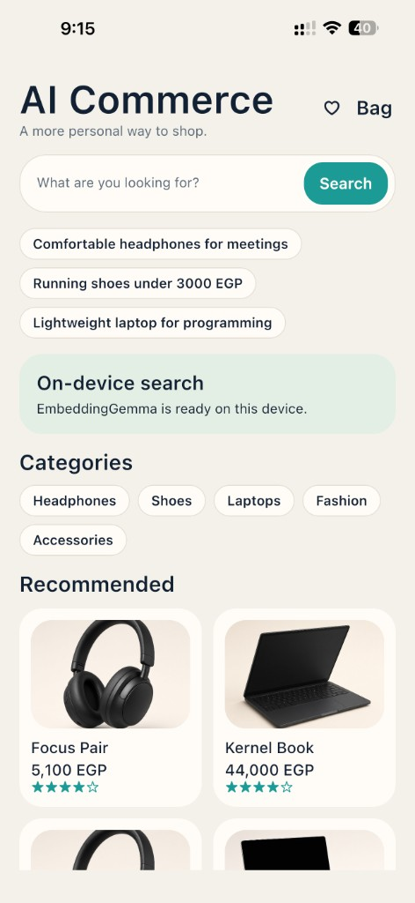
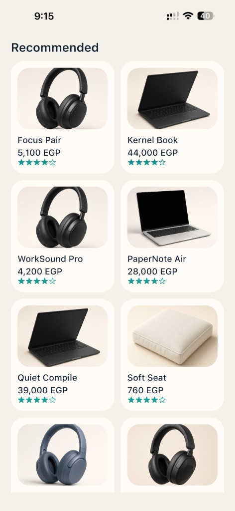
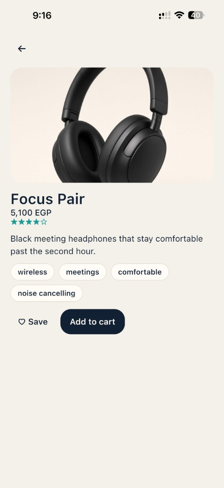
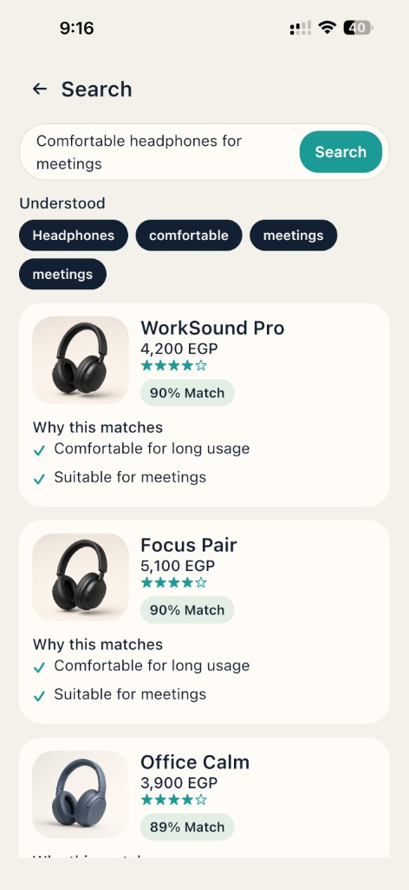
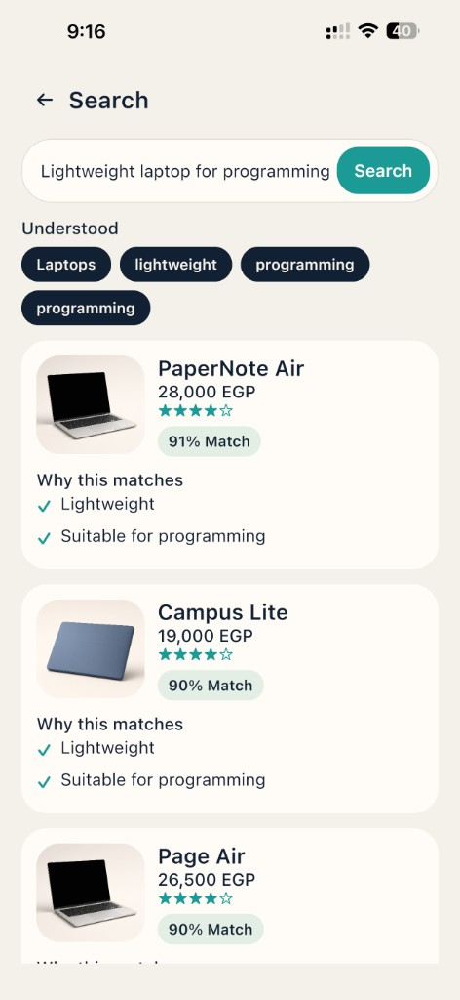
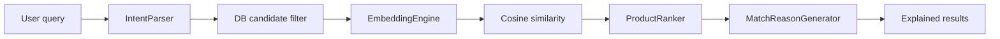
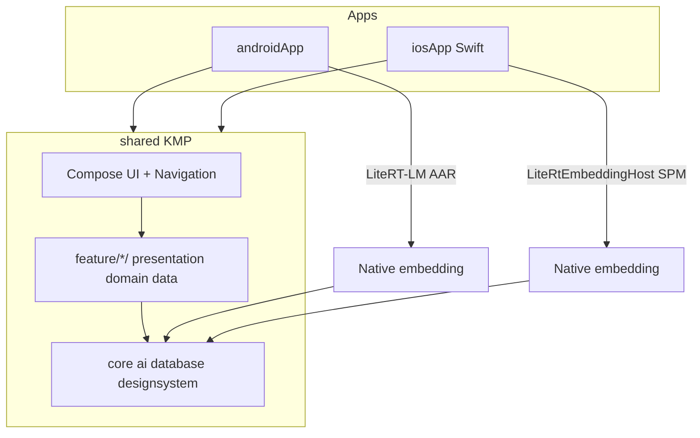

# AI Commerce

**On-device semantic product search for Android & iOS** — shoppers describe what they want in natural English or Arabic; the app ranks products entirely on the phone with EmbeddingGemma. No server, no API keys, and no query data leaves the device.

[](https://kotlinlang.org/)
[](https://www.jetbrains.com/compose-multiplatform/)
[](https://developer.android.com/)
[](https://developer.apple.com/ios/)
[](https://github.com/google-ai-edge/LiteRT-LM)
[](#)

---

## Overview

AI Commerce is a Kotlin Multiplatform shopping demo that treats search as a conversation, not a keyword box. Queries such as *"Comfortable headphones for meetings"*, *"Lightweight laptop for programming"*, or *"حذاء جري أقل من 3000 جنيه"* are parsed into structured intent, filtered against a local catalogue, embedded with **EmbeddingGemma 2 (270M)** via **LiteRT-LM**, and ranked with an explainable blend of semantic similarity, attribute match, and rating.

The UI, navigation, persistence, and search pipeline live in a shared Compose Multiplatform module. Android runs the model through the LiteRT-LM AAR; iOS runs the same model through a Swift Package Manager host bridged into Kotlin — one `EmbeddingEngine` interface, two native runtimes.

---

## Screenshots

<table>
  <tr>
    <td width="33%" align="center">
      <br />
      <sub><b>Home</b> — natural-language search, suggested queries, on-device model status, categories</sub>
    </td>
    <td width="33%" align="center">
      <br />
      <sub><b>Recommended</b> — product grid with price (EGP) and star ratings</sub>
    </td>
    <td width="33%" align="center">
      <br />
      <sub><b>Product details</b> — tags, Save (favorites), Add to cart</sub>
    </td>
  </tr>
  <tr>
    <td width="50%" align="center" colspan="1">
      <br />
      <sub><b>AI search</b> — headphones: Understood chips, match %, “Why this matches”</sub>
    </td>
    <td width="50%" align="center" colspan="2">
      <br />
      <sub><b>AI search</b> — laptops: intent extraction, ranking, explainable reasons</sub>
    </td>
  </tr>
</table>

---

## Key features

- **Natural-language search** with suggested prompts that mirror real shopping intent
- **English + Arabic** parsing with Arabic letter normalisation, diacritic stripping, and Eastern/Arabic-Indic digit mapping
- **Structured intent** — category, max price, currency (EGP/USD), colour, brand, attributes, and use case
- **Explainable results** — match percentage plus human-readable “Why this matches” reasons
- **On-device EmbeddingGemma** downloaded on demand with progress UI; optional assets copy on Android
- **Favorites & cart** persisted with Room 3 + bundled SQLite across process restarts
- **Shared Compose UI** for Android and iOS from one codebase

---

## How the AI search works



1. **`IntentParser`** — rule-based extraction for EN/AR (price clauses, categories, colours, brands, attributes, use cases).
2. **Candidate filtering** — `ProductRepository.findCandidates(intent)` narrows the Room catalogue before embedding work.
3. **Cached embeddings** — each product stores a vector tagged with `embeddingModel`; regenerated only when the model ID changes.
4. **Query embedding** — price/currency wording is stripped so semantics focus on product meaning.
5. **`ProductRanker`** — final score = **70%** semantic + **20%** attribute match + **10%** rating.
6. **`MatchReasonGenerator`** — builds the checklist shown under each result card.

---

## Architecture



| Layer | Responsibility |
| --- | --- |
| **Presentation** | Compose screens, ViewModels, `StateFlow` UI state |
| **Domain** | Use cases, repositories as interfaces, search ranking |
| **Data** | Room DAOs, mappers, sample catalogue seeding |
| **Core** | `EmbeddingEngine`, `ModelManager`, database builder, theme |

**Platform boundaries**

- `expect` / `actual` for database builder, IO dispatcher, and Koin platform module
- Shared `EmbeddingEngine` / `ModelManager` interfaces
- iOS: Kotlin `IosLiteRtHost` + Swift `LiteRtEmbeddingHost` registered through `IosLiteRtBridge`

**Feature packages** under `shared/.../feature/`: `home`, `search`, `product`, `favorites`, `cart` — each with `data` / `domain` / `presentation` where applicable.

---

## Tech stack

| Area | Choice |
| --- | --- |
| Language / targets | Kotlin Multiplatform (Android + iOS arm64 / simulator) |
| UI | Compose Multiplatform 1.12, Material 3 |
| DI | Koin 4 (`viewModel`, parameterised product details) |
| Navigation | Navigation Compose |
| Persistence | Room 3, KSP on Android + iOS, SQLite bundled |
| Async | Coroutines, `Flow` / `StateFlow` |
| Serialization | kotlinx.serialization |
| On-device AI | LiteRT-LM **0.18** — EmbeddingGemma 2 text 270M |
| Android AI | `litertlm-android` Maven artifact |
| iOS AI | Local SPM package + `fetch-prebuilts.sh` xcframeworks |
| Build | AGP 9, version catalog (`gradle/libs.versions.toml`) |

---

## Engineering highlights

These choices are intentional and visible in the codebase — the kind of trade-offs expected from senior mobile work:

1. **One product, two native AI runtimes** — shared search domain depends only on `EmbeddingEngine`; Android and iOS supply LiteRT differently without forking ranking logic.
2. **Privacy by construction** — inference and ranking never call a backend; model download is the only network path for search.
3. **Embedding cache invalidation** — vectors are keyed by model ID so a model upgrade does not silently reuse stale embeddings.
4. **Thread-safe engine lifecycle** — Android uses a `Mutex`, file stamp hot-reload, and quiet release when the model file changes or is missing.
5. **Safe downloads** — write to `.part`, rename on success, report progress via `StateFlow` for Compose UI.
6. **Testable ranking** — `FakeEmbeddingEngine` + unit tests for the search pipeline keep CI deterministic without GPU/native models.
7. **Clean architecture** — use cases and repository interfaces keep ViewModels thin and domains portable.
8. **Arabic-aware normalisation** — alif variants, taa marbuta, diacritics, and Eastern digits so bilingual queries parse reliably.

---

## Project structure

```
AiCommerce/
├── androidApp/                 # Android entry (MainActivity)
├── iosApp/                     # Xcode app + Swift LiteRT host
│   └── Packages/LiteRTLM/      # SPM wrapper; run fetch-prebuilts.sh
├── shared/                     # KMP + Compose Multiplatform
│   └── src/
│       ├── commonMain/         # UI, features, Room, search domain
│       ├── androidMain/        # LiteRT AAR engine, DB, dispatchers
│       └── iosMain/            # Bridge, DB, MainViewController
├── docs/screenshots/           # Portfolio screenshots
└── gradle/libs.versions.toml   # Single source of versions
```

---

## Getting started

### Requirements

- JDK 17+
- Android Studio (recent) / Android SDK (min SDK 29)
- Xcode + CocoaPods/SPM tooling as required by your Xcode version
- Network on first launch to download the EmbeddingGemma `.litertlm` model (unless you ship it in Android assets)

### Android

```bash
./gradlew :androidApp:assembleDebug
```

Run the `androidApp` configuration from Android Studio, or install the debug APK on a device/emulator.

### iOS

LiteRT native binaries are **not** committed (they are large). After clone:

```bash
cd iosApp/Packages/LiteRTLM
./fetch-prebuilts.sh
```

Open `iosApp` in Xcode and run the `iosApp` scheme on a simulator or device.

### Model on first search

If the model is not already available (Android assets or previous download), the search screen prompts download with progress. Minimum usable size is validated before inference.

### Tests

```bash
./gradlew :shared:testAndroidHostTest
./gradlew :shared:iosSimulatorArm64Test
```

---

## Roadmap

- Precompute product embeddings during catalogue seeding (faster first search)
- Type-safe navigation arguments instead of `SearchMemory` for product IDs
- Min price / price-range intent parsing
- Model checksum verification after download

---

## Author

**Mahmoud Atallah** — Senior Mobile Engineer

Kotlin Multiplatform · Compose Multiplatform · On-device ML · Android · iOS

<!-- Replace with your profiles:
- GitHub: https://github.com/<your-username>
- LinkedIn: https://www.linkedin.com/in/<your-handle>
-->

---

## License

Project source is available in this repository. LiteRT-LM and EmbeddingGemma are subject to their respective Google AI Edge / model licenses — review those before redistribution of binaries or weights.
